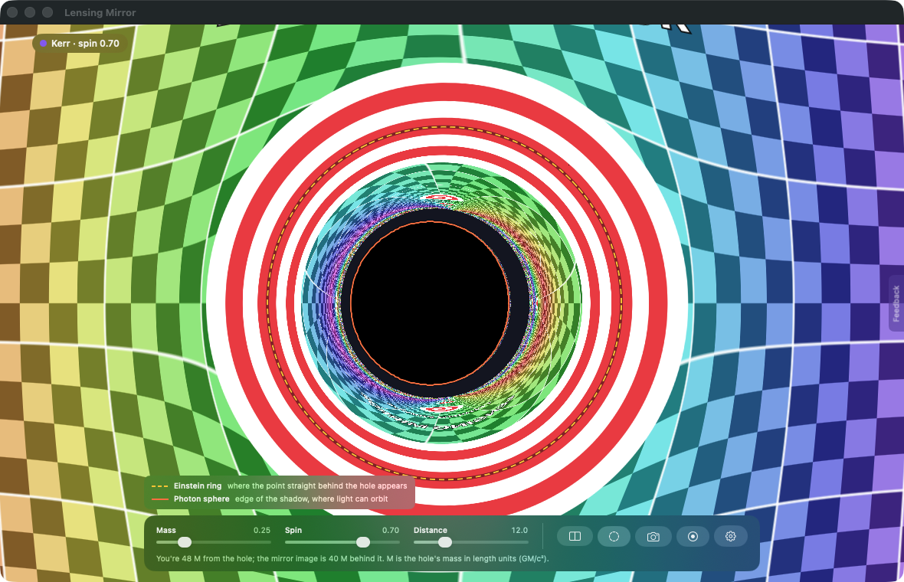
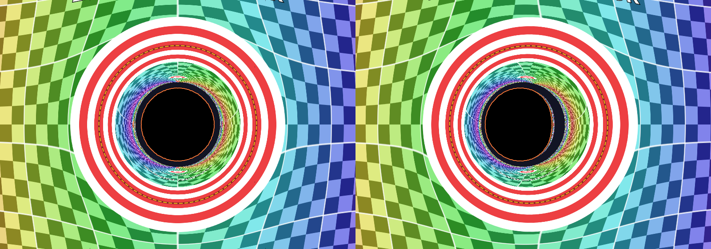
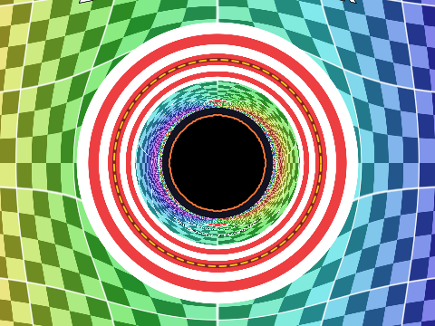
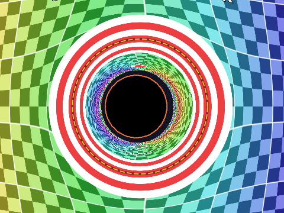
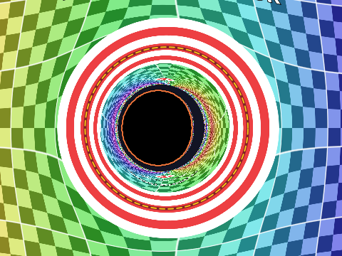
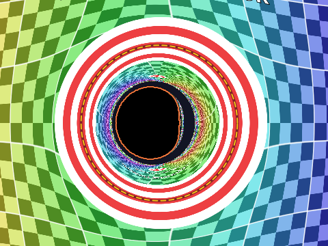
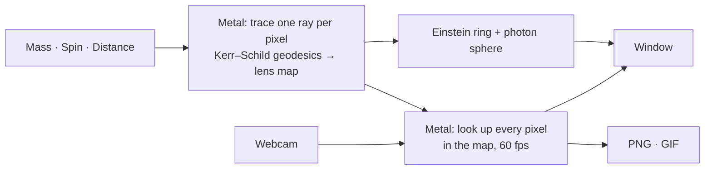

# Lensing Mirror

A live webcam mirror that bends your face through a black hole, spinning (Kerr) or not (Schwarzschild), ray-traced in Metal at 60 fps.

| No spin vs spin 0.95, side by side (Compare, ⌘D) |
|---|
|  |

| Spin 0 | Spin 0.5 | Spin 0.9 | Spin 0.998 |
|---|---|---|---|
|  |  |  |  |

Gold dashes mark the **Einstein ring** (where the point straight behind the hole shows up). Orange marks the **photon sphere** (the shadow's edge). As spin rises, the shadow shifts and flattens on one side.

## Links

- [Instructions](docs/INSTRUCTIONS.md): set up, run, use, test
- [System design](docs/SYSTEM-DESIGN.md): how it works and why
- [File structure](docs/FILE-STRUCTURE.md): what's where
- Builds on [Black Hole Simulator](https://amalmehta.github.io/BlackHoleSimulator/)
