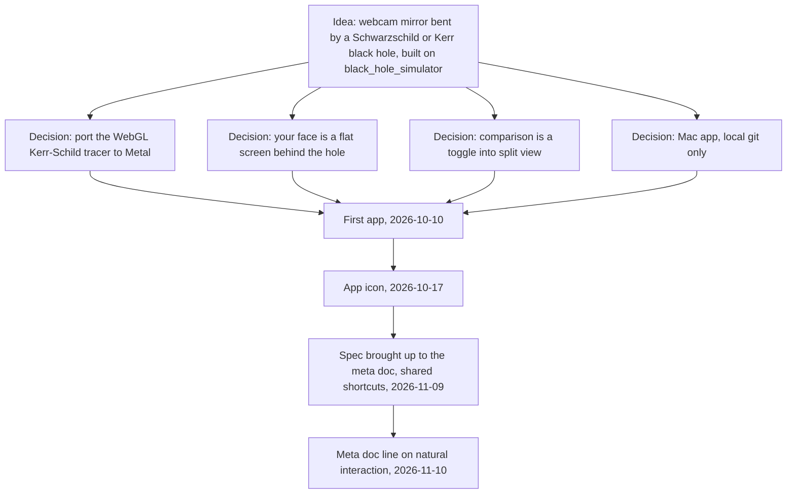
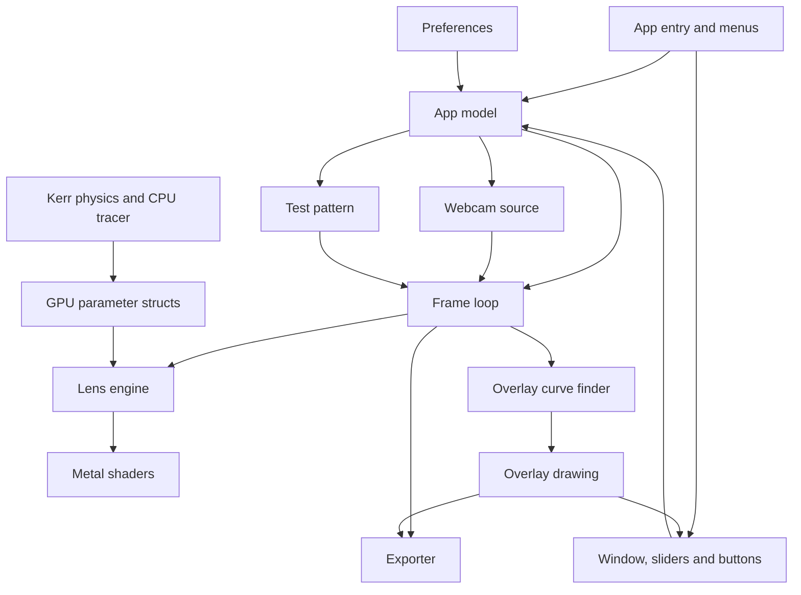
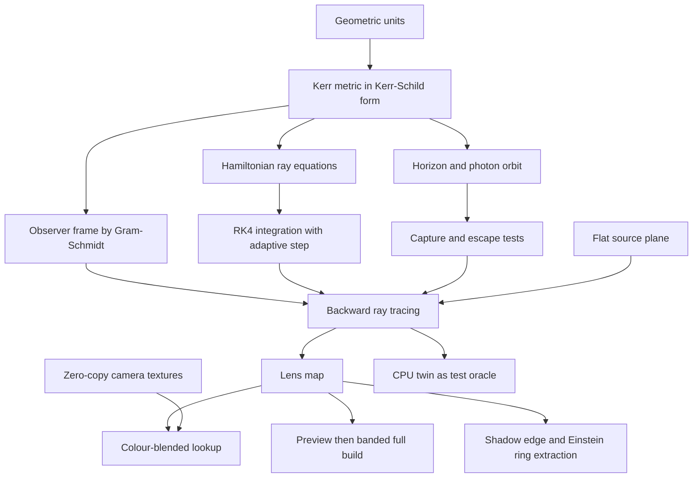

<!-- ProjectForge explainer at d79e5e7 -->
# How Lensing Mirror was built

Lensing Mirror is a Mac app that shows your live webcam image bent by a black hole, in real time. It is for anyone who wants to see gravitational lensing happen to their own face, with sliders for mass, spin and distance. The one idea that makes it work: the expensive part, tracing a curved light ray for every pixel, depends only on the sliders, not on the video. So the rays are traced once into a "lens map", and each video frame is just a lookup through that map.

## Build history

- **First app, 2026-10-10.** The whole app arrived in one commit: a live webcam mirror lensed through a Kerr black hole. It covers the spec's deliverables: the Metal tracer, the spin slider with a Schwarzschild split view, the Einstein ring and photon sphere overlay, and PNG and GIF export. It follows the four decisions above.
- **App icon, 2026-10-17.** Added the app icon (`Sources/App/Assets.xcassets/AppIcon.appiconset/`).
- **Spec and shortcuts, 2026-11-09.** Updated the spec (`Lensing Mirror.md`) to match the current meta doc, and added the shared `Shortcuts.md`.
- **Meta doc line, 2026-11-10.** Added the meta doc's line about fitting how people naturally interact with the world.

## Code map

| Part | File | What it does |
|---|---|---|
| App entry and menus | `Sources/App/LensingMirrorApp.swift` | Opens the window and settings, and adds the Mirror menu shortcuts (⌘T, ⌘R, ⌘D, ⌘L). |
| App model | `Sources/App/AppModel.swift` | Holds the slider values, converts them to units of M, picks the image source and starts exports. |
| Preferences | `Sources/App/Preferences.swift` | Every setting (camera, mirror distance, field of view, resolution, accuracy, export), saved to UserDefaults. |
| Window, sliders and buttons | `Sources/UI/ContentView.swift`, `Sources/UI/ControlBar.swift` | Stacks the Metal view, overlay, pane labels, status banners and control bar. |
| Webcam source | `Sources/Camera/CameraSource.swift` | Turns AVFoundation camera frames into Metal textures without copying them. |
| Test pattern | `Sources/Camera/TestPattern.swift` | Draws a coloured grid with a target in the middle, for when there is no camera. |
| Frame loop | `Sources/Rendering/MirrorRenderer.swift` | Runs every frame: decides when to trace lens maps, draws, triggers overlay and exports. |
| Kerr physics and CPU tracer | `Sources/Physics/Kerr.swift` | Black hole formulas, the observer's camera frame, and a double-precision twin of the GPU tracer. |
| GPU parameter structs | `Sources/Rendering/GPUTypes.swift` | Packs the physics setup into the exact byte layout the shader expects. |
| Lens engine | `Sources/Rendering/LensEngine.swift` | Compiles the shader, builds lens maps, composites panes, reads results back to the CPU. |
| Metal shaders | `Sources/Rendering/LensShaders.msl` | The ray-tracing compute kernel and the full-screen lookup shader. |
| Overlay curve finder | `Sources/Overlay/LensCurves.swift` | Finds the shadow edge and the Einstein ring by walking outward through a lens map. |
| Overlay drawing | `Sources/Overlay/OverlayLayer.swift` | Pane layout, live overlay drawing, and burning the overlay into exported images. |
| Exporter | `Sources/Export/Exporter.swift` | Writes PNG snapshots and looping GIFs, and collects GIF frames as they finish. |

## Concepts

**Geometric units** — Physics constants are set so that G = c = 1 and the hole's mass M = 1. Every distance is then a multiple of M (for the Sun, M is about 1.5 km). The mass slider does not enter the equations directly. Instead `AppModel.distanceInM` divides the scene distance by the mass, with a floor of 6 M. `planeInM` does the same for the mirror distance, with a floor of 4 M. So a heavier hole looks the same as moving closer. Lives in `Sources/Physics/Kerr.swift` (header comment) and `Sources/App/AppModel.swift`.

**Kerr metric in Kerr–Schild form** — A metric is the rule that measures distances and times in curved spacetime. The Kerr metric describes a spinning black hole. Spin `a` runs from 0 (a non-spinning Schwarzschild hole) to just under 1; the slider stops at 0.998. Kerr–Schild coordinates are ordinary-looking Cartesian x, y, z, plus time, with the spin axis along z. In them, the inverse metric is flat space minus one extra term:

$$g^{\mu\nu} = \eta^{\mu\nu} - f\, l^\mu l^\nu,\qquad f = \frac{2r^3}{r^4 + a^2 z^2},\qquad l = \left(\frac{rx + ay}{r^2+a^2},\ \frac{ry - ax}{r^2+a^2},\ \frac{z}{r}\right)$$

Here `r` is not the plain distance. It is the root of $r^4 - (\rho^2 - a^2) r^2 - a^2 z^2 = 0$, where $\rho^2 = x^2+y^2+z^2$. This form has no blow-up at the horizon and needs no sines or cosines, which suits a GPU. The project needs it because spin is a core feature. Setting a = 0 gives Schwarzschild for free, which powers the split view. It lives in `Kerr.radius` and `Kerr.fields` (`Sources/Physics/Kerr.swift`), and in `kerrRadius` and `kerrDeriv` (`Sources/Rendering/LensShaders.msl`). It is a port of black_hole_simulator's `physics.js`, as the header of `Kerr.swift` says.

**Hamiltonian ray equations** — Light follows a geodesic, the "straightest" path through curved spacetime. One way to compute it is to treat the light ray like a particle. It has a position `q` and a momentum `p`, and the Hamiltonian $H = \tfrac12 g^{\mu\nu}p_\mu p_\nu$ must stay 0 for light. With the time part of the momentum fixed at $p_t = -1$, Hamilton's equations reduce to:

$$\frac{dq}{d\lambda} = p - f\,(1 + l\cdot p)\,l,\qquad \frac{dp}{d\lambda} = \tfrac12\,\nabla\!\left[f\,(1 + l\cdot p)^2\right]$$

The gradient ∇ is taken with `p` held fixed, and λ is a parameter along the ray. The code works out the gradient by hand with the chain rule (the `dr`, `dQ`, `df`, `dS` terms) rather than with finite differences. These equations bend the light; everything else is bookkeeping. They live in `Kerr.deriv` and `Kerr.hamiltonian` (`Sources/Physics/Kerr.swift`) and in `kerrDeriv` (`Sources/Rendering/LensShaders.msl`). `testHamiltonianStaysNullAlongARay` in `Tests/PhysicsTests.swift` checks that H stays within 1e-6 of 0 after 400 steps.

**RK4 integration with adaptive step** — Classic fourth-order Runge–Kutta (RK4) takes one step by sampling the derivative four times and averaging them. The step is negative, because rays are traced backwards from the eye. Its length follows the rule in `LensTracer.trace` and the shader:

$$h = -k\, r\, \frac{\operatorname{clamp}\big(2(r - r_+),\ 0.05,\ 1\big)}{\max(|\dot q|, 1)}$$

Steps grow with distance from the hole. They shrink only within half an M of the horizon $r_+$, so rays that skim the photon orbit are not slowed down. `k` comes from the Accuracy setting: 0.08 for Fast, 0.05 for Balanced, 0.025 for Precise (`Preferences.Accuracy.stepK`). Lives in `Kerr.rk4` and `LensTracer.trace` (`Sources/Physics/Kerr.swift`) and in `buildLensMap` (`Sources/Rendering/LensShaders.msl`).

**Observer frame by Gram–Schmidt** — A pixel's angle only means something relative to a real observer. `CameraFrame` puts a static observer at (−D, 0, 0) looking along +x, with up along the spin axis +z and right along +y. It builds the observer's 4-velocity `u` and three spatial axes. It makes them orthonormal with Gram–Schmidt, using the curved metric's inner product rather than the flat one. `initialMomentum(tx:ty:)` then turns a pixel direction into a light momentum. It lowers the index with the metric and scales so that $p_t = -1$. Without this step, pixel angles near the hole would be wrong. Lives in `Sources/Physics/Kerr.swift`, is copied into `MapParams` (`Sources/Rendering/GPUTypes.swift`), and is used at the top of `buildLensMap`. Tested by `testCameraFrameIsOrthonormal` and `testInitialMomentumIsNull`.

**Horizon and photon orbit** — The outer event horizon is at $r_+ = 1 + \sqrt{1 - a^2}$. Nothing comes back from inside it. The prograde equatorial photon orbit is at $r_{ph} = 2\left(1 + \cos\!\left(\tfrac23 \arccos(-a)\right)\right)$. Prograde means the light circles the same way the hole spins. This is the closest radius where light can circle the hole; for a = 0 it is 3 M. The edge of the black shadow is light that skimmed this orbit. Lives in `Kerr.horizon` and `Kerr.photonOrbit` (`Sources/Physics/Kerr.swift`).

**Capture and escape tests** — These end each ray early so the loop stays short. A ray counts as captured in any of these cases:
- it gets within 0.02 M of the horizon;
- its momentum blows up (|p|² > 10⁴);
- it is inside 0.98 × the prograde photon orbit and still heading inward. No photon orbit lies deeper than that, so it cannot come back out.

A ray counts as escaped when it is beyond `escapeRadius` = 1.2 × max(D, S) + 10 and heading outward. Lives in `LensSetup.captureRadius` and `escapeRadius` (`Sources/Physics/Kerr.swift`) and in the loop of `buildLensMap`.

**Flat source plane** — This is the "flat screen behind the hole" decision. The webcam image is treated as a flat plane at x = S behind the hole. The observer is in front, at x = −D. When a traced ray crosses x = S, the code interpolates the crossing point linearly between the two steps. A ray that escapes first is carried on in a straight line to the plane. If it never reaches the plane, it is marked "missed". The hit point's (y, z) is multiplied by

$$\text{sourceScale} = \frac{1}{(D+S)\tan(\text{fov}/2)}$$

With this scaling, an undeflected ray from screen point (x, y) maps back to (x, y). With no hole, the mirror shows your plain image. Lives in `LensSetup.sourceScale` (`Sources/Physics/Kerr.swift`) and in `buildLensMap`.

**Backward ray tracing** — Rays start at the eye and run backwards in time to wherever the light came from. That gives exactly one ray per output pixel. Each ray ends in one of three outcomes: captured (black shadow), mirror (a point on the webcam plane) or missed (light from behind you). The GPU kernel `buildLensMap` (`Sources/Rendering/LensShaders.msl`) does this per texel. `LensTracer.trace` (`Sources/Physics/Kerr.swift`) does the same thing line for line.

**Lens map** — A lens map is an RGBA32Float texture, with one texel per traced ray. Its value is `(sourceX, sourceY, kind, 0)`, where kind is 0 captured, 1 mirror, 2 missed. A `MapKey` (the setup plus the size) identifies it. A new key means a new map. It only changes when a slider, preference or window size changes. This is what makes 60 fps possible: the per-frame cost becomes one texture lookup. Lives in `LensMap` and `MapKey` (`Sources/Rendering/LensEngine.swift`).

**Colour-blended lookup** — `compositeFragment` finds the four map texels nearest each screen pixel. It turns each texel into a colour with `tapColor` (black for captured, dark blue (0.07, 0.08, 0.14) for missed, a camera sample for mirror), then blends the four colours. It does not blend the four source coordinates. Blending coordinates would smear across the shadow edge and across folds, where nearby texels point to far-apart parts of the image. Blending colours keeps those edges smooth even when the map is coarser than the screen. `tapColor` scales so that the camera image fills the pane when unlensed. It also flips left-right for a mirror feel. The sampler uses `mirrored_repeat`, so rays that land outside the camera frame still get a reflected copy of the image. Lives in `Sources/Rendering/LensShaders.msl`.

**Preview then banded full build** — Tracing a full map takes longer than one frame. So while a slider moves, and for 0.25 s after (`settleDelay`), the renderer traces a quick preview every frame. The preview has at most 0.3 rays per point, a step factor of at least 0.08 and at most 500 steps (`LensSetup.preview`). Once things settle, it traces the full map a band of rows per frame, behind the live picture, and swaps the map in when it is done. The band starts at 16 rows. After each frame it shrinks to 0.7× if GPU time went over 1.3 × 9 ms, and grows to 1.25× if it stayed under 0.8 × 9 ms, within 1 to 4096 rows. Lives in `MirrorRenderer.draw` (`Sources/Rendering/MirrorRenderer.swift`), with the `rowOffset` field of `MapParams` letting `buildLensMap` trace only part of the map.

**Shadow edge and Einstein ring extraction** — The overlay curves come from the lens map itself, so they match the spinning geometry exactly. `LensCurves.extract` walks outward from the centre along 240 directions, in half-texel steps.
- **Photon sphere:** the first point that is not captured is the shadow edge, which the overlay labels "Photon sphere".
- **Einstein ring:** past that edge, the code watches the source position projected onto the walk direction. Where it flips from negative to positive, you are looking at the point straight behind the hole. The outermost flip is the primary Einstein ring, and the code interpolates linearly between the two samples.

For a = 0 the closed forms are a shadow angle of $\sin\alpha = \frac{3\sqrt3}{D}\sqrt{1 - 2/D}$ and a weak-field ring of $\theta_E = \sqrt{4S/(D(D+S))}$. The tests check against both (`Schwarzschild` in `Sources/Physics/Kerr.swift`). The map is copied to the CPU with `LensEngine.readback`, and the curves are found off the main thread in `MirrorRenderer.readOverlay`. Code lives in `Sources/Overlay/LensCurves.swift` and is drawn by `Sources/Overlay/OverlayLayer.swift`.

**Zero-copy camera textures** — `CVMetalTextureCache` wraps the camera's own pixel buffer as a Metal texture, with no copy. The catch is that the `CVMetalTexture` must stay alive until the GPU is done with it. `SourceFrame.keepAlive` holds it, and `draw` captures `source` in the command buffer's completion handler for this reason. The capture output drops late frames (`alwaysDiscardsLateVideoFrames`), and the camera asks for a 60 fps format up to 1920 px wide when it has one. Lives in `Sources/Camera/CameraSource.swift` and `Sources/Rendering/MirrorRenderer.swift`.

**CPU twin as test oracle** — An oracle is a trusted reference that test results are checked against. A shader is hard to debug, so `LensTracer` (Swift, double precision) mirrors `buildLensMap` (Metal, single precision) line for line. The physics tests check the CPU twin against closed forms:
- the Schwarzschild shadow, within 0.3%;
- the Einstein ring against the second-order thin-lens deflection $\alpha(b) = 4/b + \tfrac{15\pi}{4}/b^2$, within 1%;
- the lens equation;
- the sideways shift of a spinning shadow.

`testShaderMatchesCPUTracer` then requires at least 98% of sampled GPU texels to agree with the twin. The allowance covers rays that graze the shadow edge, where float and double precision can disagree. To keep the two close, the shader is compiled with `fastMathEnabled = false`. It ships as source and is compiled at launch (`LensEngine.init`, `Sources/Rendering/LensEngine.swift`; `project.yml` copies `LensShaders.msl` as a resource). `testStructLayoutsMatchTheShader` checks that the Swift structs are 160 and 48 bytes, the same as the shader's. Lives in `Tests/PhysicsTests.swift` and `Tests/GPUTests.swift`.

## One input, start to finish

The input is one webcam frame. Assume the user has just let go of the spin slider and the full map is already built.

1. **Camera delivers a frame.** AVFoundation calls `CameraSource.captureOutput(_:didOutput:from:)` (`Sources/Camera/CameraSource.swift`) on its frame queue. The function wraps the BGRA pixel buffer as a Metal texture with `CVMetalTextureCacheCreateTextureFromImage`. It stores the result as `latest`, under a lock, in a `SourceFrame` that keeps the `CVMetalTexture` alive.
2. **The view asks for a frame.** `MTKView`, set to 60 fps in `MirrorView.makeNSView` (`Sources/Rendering/MirrorRenderer.swift`), calls `MirrorRenderer.draw(in:)`. That calls `AppModel.currentSource()` (`Sources/App/AppModel.swift`), which returns `camera.currentFrame`, the frame from step 1. With no camera, it returns the test pattern.
3. **Decide which map to use.** `draw` gets the pane layouts from `AppModel.paneLayouts`, which calls `PaneLayout.layouts` in `Sources/Overlay/OverlayLayer.swift`. That is one pane, or two when Compare is on: spin 0 on the left and your spin on the right. For each pane it builds the full `MapKey` from `AppModel.setup(spin:)`. More than 0.25 s has passed since `lastLensChange`, so it does not trace a preview. If `maps[i]` already has the full key, nothing is traced this frame.
4. **(When the map was being built.)** On earlier frames, `draw` called `LensEngine.allocateMap` and then `LensEngine.encodeRows` (`Sources/Rendering/LensEngine.swift`) once per frame for a band of rows. `encodeRows` fills `MapParams.init` (`Sources/Rendering/GPUTypes.swift`), which builds a `CameraFrame` (`Sources/Physics/Kerr.swift`). It then dispatches `buildLensMap` (`Sources/Rendering/LensShaders.msl`) in 8×8 threadgroups. For one texel, the kernel:
   - turns the pixel into a direction (tx, ty);
   - builds the photon momentum from the observer's frame;
   - runs RK4 steps with `kerrDeriv` until the ray is captured, crosses the plane x = S, or escapes;
   - writes `(sourceX, sourceY, kind, 0)`.

   When the last band finished, `draw` swapped the map into `maps[i]`.
5. **Overlay curves.** If the overlay is on and this map's key is new, `MirrorRenderer.readOverlay` asks `LensEngine.readback` to blit the map into a shared buffer. When the GPU finishes, `LensCurves.extract` (`Sources/Overlay/LensCurves.swift`) finds the shadow edge and Einstein ring and stores them in `model.curves`. `OverlayLayer` (`Sources/Overlay/OverlayLayer.swift`) draws them over the picture, with the ring dashed.
6. **Composite.** `draw` opens a render pass on the view's drawable and calls `LensEngine.encodeComposite`. That sets each pane's viewport and draws one full-screen triangle (`fullscreenVertex`). For every screen pixel, `compositeFragment` (`Sources/Rendering/LensShaders.msl`):
   - reads the four nearest map texels;
   - colours each with `tapColor`: black, dark blue, or the camera texture at the lensed spot, flipped left-right when `AppModel.mirrorsSource` is true;
   - blends the four colours.
7. **Show it.** `draw` presents the drawable and commits the command buffer. A completion handler keeps `source` alive until the GPU is done, and updates the smoothed GPU time shown in the frame-rate readout (`Sources/UI/ContentView.swift`).
8. **(If the user pressed ⌘T.)** `AppModel.takeSnapshot` set `snapshotRequested`. So `draw` also calls `encodeSnapshot`, which renders the same panes offscreen with `LensEngine.encodeOffscreen`. Off the main thread, it converts the result with `LensEngine.image(from:width:height:)`. It adds the overlay with `OverlayDrawing.compose` when "overlay in exports" is on. Then it writes a PNG with `Exporter.writePNG` (`Sources/Export/Exporter.swift`), named like a macOS screenshot. GIFs work the same way, one frame per `GIFCapture.claimFrame` tick, and are written by `Exporter.writeGIF`.

## Where this came from

Written from the spec, the author's decisions, the git history and the code as of commit d79e5e7 (2026-11-10).
