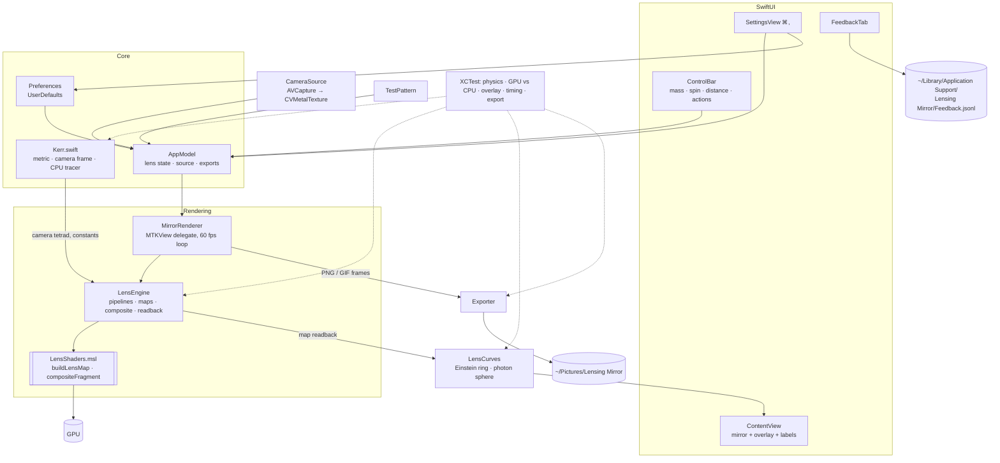

# System design

Lensing Mirror is a native Mac app (SwiftUI + Metal). It shows the live webcam as if it were a flat screen some distance behind a black hole, so you see your own face bent, ringed and doubled by real general relativity. The black hole can be non-spinning (Schwarzschild) or spinning (Kerr), and it's set by three sliders: mass, spin and distance.

It builds on [Black Hole Simulator](../../black_hole_simulator): the Kerr–Schild ray equation, its analytic gradient and the step-size rule are ported line for line from that project's `physics.js` and GLSL shader to Swift and Metal.

## Architecture

## Components

| Component | Job |
|---|---|
| `Physics/Kerr.swift` | The maths, in units G = c = M = 1. Horizon, photon orbits, critical impact parameter; the Kerr–Schild Hamiltonian ray equation with its analytic gradient and an RK4 step; closed-form Schwarzschild checks (shadow angle, Einstein angle). `CameraFrame` builds a **static observer's** 4-velocity and an orthonormal triad by Gram–Schmidt in the full metric, so the pixel angles are angles that observer would really measure. `LensTracer` is the CPU twin of the GPU kernel, used by the tests. |
| `Rendering/LensShaders.msl` | Metal Shading Language. `buildLensMap` traces one ray per texel backwards from the camera and writes where on the mirror plane the light came from (or "captured" / "missed"). `compositeFragment` looks each screen pixel up in the map and samples the camera image there, blending the four nearest map texels' *colours* so the shadow edge stays smooth when the map is coarser than the screen. Shipped as source and compiled at launch (see decisions). |
| `Rendering/LensEngine.swift` | Metal with no UI: compiles the shaders, allocates maps, encodes full or banded map builds, composites panes into a render pass or an offscreen texture, and copies maps or frames back to the CPU. Used by both the window and the tests. |
| `Rendering/MirrorRenderer.swift` | The `MTKView` delegate. Each frame: decide which map each pane needs, build or continue building it, composite the camera through it, present, and hand snapshot or GIF frames to the exporter. Measures frame rate and GPU time. |
| `Overlay/LensCurves.swift` | Reads the overlay's two curves straight off a lens map (see flows). Also builds the `CGPath`s used both on screen and in exports. |
| `Overlay/OverlayLayer.swift` | Pane layout (single, or Schwarzschild left / Kerr right), the SwiftUI overlay and legend, and drawing the overlay into exported images. |
| `Camera/CameraSource.swift` | AVFoundation capture: picks the device, asks for a 60 fps format when the camera has one, and wraps each frame's pixel buffer as a Metal texture with no copy. Reports running / denied / unavailable. |
| `Camera/TestPattern.swift` | A built-in coloured grid with a target in the middle. Used when there's no camera, access is denied, the setting asks for it, or tests are running. |
| `Export/Exporter.swift` | PNG and looping GIF writing (ImageIO), file names like a macOS screenshot, and `GIFCapture`, which books frames at the GIF's frame rate and collects them as they finish. |
| `App/AppModel.swift` | Observable state: sliders, compare and overlay toggles, curves, frame rate, source status, toasts, GIF progress. Turns scene units into units of M. |
| `App/Preferences.swift` | Every preference, saved to UserDefaults, with reset to defaults. |
| `UI/*` | Window, control bar, Settings (Camera, Lens, Export tabs), feedback tab, and the colour palette. |

## Main flows

**A frame (60 fps).** `MirrorRenderer.draw` runs on the display link.
1. Work out the panes: one, or two halves when comparing (left spin 0, right your spin).
2. For each pane, the map it wants is keyed by spin, D/M, S/M, field of view, step size and size in texels. If the sliders moved in the last 0.25 s, or the window is resizing, it wants a **preview** map: 0.3× the resolution, a coarser step and at most 500 steps. That's traced in full this frame (see Testing for timings). Otherwise it wants the **full** map, which is traced a band of rows per frame into a separate texture. A controller grows or shrinks the band to keep the frame's GPU time near 9 ms. When the last band is done, the full map replaces the preview.
3. Composite: one fragment pass per pane, a map lookup plus four camera samples per pixel. It takes about 0.7 ms of GPU time for a 2360 × 1520 window on a Radeon Pro 5300M.
4. If a snapshot is pending or a GIF frame is due, the same composite is drawn into an offscreen texture and copied back in the same command buffer.

**Tracing one ray** (`buildLensMap`, mirrored by `LensTracer.trace`).
1. Pixel → direction in the observer's frame: `n = (forward + tx·right + ty·up)/|…|`. The photon's 4-momentum is `u − n`, lowered with the metric and scaled to p_t = −1.
2. Integrate Hamilton's equations backwards with RK4. Each step has a spatial length of `k·r·clamp(2(r − r₊), 0.05, 1)`, so it only shrinks within half an M of the horizon.
3. Stop when:
   - **captured:** r is within 0.02 of r₊, the momentum blows up, or the ray is inside the prograde photon orbit and still heading in (light from outside can't come back from there);
   - **mirror:** the ray crosses the plane x = S, and the hit is stored in "unlensed screen" units, so a ray that wasn't bent maps back to its own pixel;
   - **escaped:** r passes the escape radius moving outward. It's extended in a straight line to the plane if it's heading that way, otherwise it's **missed** (light from empty space behind you).

**The overlay.** After a map is built it's copied back (a few MB) and `LensCurves.extract` runs off the main thread. Along 240 directions from the hole it walks outward:
- **Photon sphere:** where texels stop being captured, which is the shadow's edge.
- **Einstein ring:** the outermost place where the source position, projected on that direction, flips from negative to positive. That's where the point straight behind the hole appears.

Both come from the same map as the picture, so they follow the Kerr shadow's shift and flattening exactly. A generation counter drops stale results.

**Export.** Snapshots are PNGs at window resolution. GIFs default to 3 s at 15 fps and 640 px wide. Frames are rendered offscreen while you keep using the app, then encoded off the main thread. If the overlay is showing and *Include the overlay* is on, it's drawn into each image with CoreGraphics. A toast offers *Show in Finder*.

## Where data lives

| Data | Where |
|---|---|
| Preferences | `UserDefaults` (domain `com.amalmehta.LensingMirror`) |
| Snapshots and GIFs | `~/Pictures/Lensing Mirror/` by default (changeable in Settings → Export) |
| Feedback notes | `~/Library/Application Support/Lensing Mirror/Feedback.jsonl`, one JSON object per line. Nothing is sent. |
| Camera frames, lens maps | GPU memory only; never written to disk except as exports you ask for |

## Key decisions and trade-offs

| Decision | Why | Cost |
|---|---|---|
| **Precompute a lens map; per frame only look it up.** | The bending depends on mass, spin, distance and view, not on the camera image. A frame becomes a 0.7 ms lookup, so 60 fps is easy. | Changing a slider needs a new map: previews while dragging, then a sharper map a moment later. |
| **Full maps built in bands across frames.** | A full map is 0.1 s (cool) to 0.4 s (thermally throttled) of GPU work on this Mac. Building it all at once would stall the picture. | It sharpens over a fraction of a second to a second instead of instantly. |
| **Static observer with a real tetrad**, not coordinate directions. | Shadow and ring sizes then match the textbook formulas for an observer at rest. The tests check the shadow to 0.3%. | A little setup per map, done on the CPU. |
| **One integrator (Kerr–Schild) for every spin**, including 0. | The simulator used a faster Schwarzschild path. Here both comparison panes must use the same method and coordinates, or differences would come from the method rather than the spin. | Spin 0 costs as much as spin 0.9. |
| **Webcam as a flat plane behind the hole** (chosen with you). | It feels like a mirror: your face's centre becomes the Einstein ring. | Light that loops round the hole heads back toward you and misses the plane. It's drawn dark navy (not shadow-black) just outside the shadow, widest on the side spinning toward you. |
| **Early capture inside the prograde photon orbit.** | Rays that fall in were taking 1,200–3,700 steps to creep to the horizon. Tested on 14,400 rays with no outcome changed. | None found. It's a sufficient condition, so some captured rays still take the long way. |
| **Step shrinks only within ½ M of the horizon** (the simulator shrank it within 2 M). | Rays skimming the photon orbit were the slowest in the map, since a GPU row is only as fast as its slowest ray. Checked against a 10× finer trace: no ray moved more than 1% of the screen height. | Slightly less margin very close to a fast-spinning horizon. |
| **Shader compiled from source at launch** (`LensShaders.msl`). | Xcode 26 ships the Metal compiler as a separate ~700 MB download, which this machine didn't have. Compiling at runtime takes a fraction of a second and needs nothing extra. | Shader errors show up at launch, not build time (the tests catch them). |
| **No sandbox, ad-hoc signed.** | Runs locally from a build with no Developer ID. | Not ready for the Mac App Store as is. |

## Testing

`xcodebuild test` runs 20 XCTests, plus a 21st that renders the README images and is skipped by default:
- **Physics** (`PhysicsTests`): closed-form radii; the camera triad is orthonormal in the metric; initial momenta are null; the Hamiltonian stays null along a ray (≤ 1e−6); the traced Schwarzschild shadow matches the closed form to 0.3%; spin makes the shadow lopsided sideways but not vertically; the Einstein ring and image positions match the thin-lens equation with the second-order deflection 4/b + 15π/(4b²).
- **GPU** (`GPUTests`): struct layouts match the shader; the Metal map agrees with the CPU tracer on ≥ 98% of sampled rays (float vs double can flip a ray grazing the shadow); the overlay finds the analytic shadow and the bisected ring within two texels; the Kerr shadow is shifted; a Retina composite fits in half a 60 fps frame; previews fit in a 30 fps frame and one row of a full map fits in the per-frame budget; PNG and GIF exports read back with the right size and frame count.
- **Frame loop** (`RendererTests`): drives `MirrorRenderer.draw` on a real `MTKView` with no clicks. It covers the preview-then-full map handoff, overlay curves (ring outside the shadow), compare mode's two panes, and a snapshot and a 10-frame GIF saved through the app's own export path.
- **Support** (`SupportTests`): file names; GIF frame pacing; feedback appends; curve extraction on a synthetic map with a known ring.
- **By hand:** the app was run on the test pattern and checked by eye (shadow, rings, overlay, the navy band of light from behind you), with the frame rate logged at a steady 60.0 fps.

Measured on a 2019 MacBook Pro 16″ (Radeon Pro 5300M):

| | Cool | Thermally throttled |
|---|---|---|
| Frame (composite, 2360 × 1520) | 0.67 ms | 1.4 ms |
| Preview map while dragging (354 × 228) | 5–6 ms | 19–26 ms |
| Full map (1180 × 760), spread across frames | 104–125 ms | 330–425 ms |
| Steady frame rate in the app | 60.0 fps | — |

## Known limits

- **The physics is exact; the scene is an idealisation.** The observer is at rest on the equator, and the spin axis points up the screen. The mirror is an infinite flat plane, mirrored and repeated past the camera's frame edge. Distances are in units of M, so it's about shape, not scale: a real black hole that bent your face like this would be a few millimetres across and would kill you.
- **No brightness change.** Lensing conserves surface brightness, so none is applied. The frequency shift between the plane and you (gravitational redshift) is ignored, because it's the same for every pixel.
- **Previews are approximate** at the shadow edge (coarser step, 500-step cap) until the full map arrives.
- **Near spin 1**, a few rays that hug the horizon still hit the 4,000-step cap. They're treated as captured, which they almost certainly are.
- **Performance figures** are from one 2019 MacBook Pro 16″ (Intel i9, Radeon Pro 5300M). The machine thermally throttled during testing, which slowed full-map builds by up to about 2×. Apple Silicon should be faster.
- **The camera usually delivers 30 fps** unless it has a 60 fps mode. The picture redraws at 60 fps either way.
- **Not tested here:** the first-launch camera permission prompt and a live camera feed (computer-use access wasn't granted, and the camera prompt is yours to answer). Nothing was clicked: the Settings window, the feedback popover and slider drags weren't exercised by hand. The frame loop, exports and feedback store are covered by tests.
